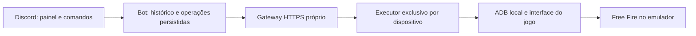

# Como conectar o bot a salas reais

Mercado Pago e Efí são integrações financeiras. IMAP lê mensagens de e-mail e pode
auxiliar a conferência de recebimentos; não cria salas nem equivale à consulta
bancária de uma cobrança. Nenhum desses nomes identifica um fornecedor de salas.

Ainda não há fornecedor contratado nem emulador informado pelo cliente. Portanto,
a decisão de backend está aberta; não é necessário o cliente já conhecer uma API.

## Alternativas

| Caminho | O que exige | Limitação a validar |
| --- | --- | --- |
| API de fornecedor | Documentação, conta, acesso e cotas | Suportar as operações obrigatórias e confirmar ID/senha no jogo |
| Executor próprio com emulador | Máquina dedicada, Android/jogo, conta e ADB autorizado | Reconhecer telas/estados reais e resistir a alterações do jogo |

Uma API compatível e testável reduz a manutenção da interface do jogo. Com as novas
prioridades de custo/facilidade/prazo, a recomendação é qualificar uma API comercial
primeiro, conforme [VIABILIDADE.md](VIABILIDADE.md). O emulador permanece alternativa
mediante prova de conceito na máquina do cliente. Não há essa automação pronta.

## Estrutura para a alternativa própria



O gateway poderá implementar o [contrato v2](ROOM_API_V2.md) já usado pelo bot.
`ROOMS_PROVIDER=api` só pode apontar para ele depois que existir e passar pelos
testes desse contrato. Esse ajuste não transforma ADB em uma API do Free Fire.

O executor precisará:

1. Registrar pedido e referência antes de qualquer ação no jogo.
2. Serializar o trabalho por dispositivo/conta e respeitar a capacidade medida.
3. Identificar a tela e aplicar apenas as opções comprovadamente disponíveis.
4. Ler e conferir ID/senha e opções aplicadas antes de responder ao bot.
5. Recuperar o pedido após falha sem clicar novamente em criar.
6. Demonstrar edição, cancelamento e encerramento reais quando suportados.

Se houver falha entre criar a sala e ler o ID, o pedido continua incerto até uma
verificação confiável. Deixar a sala ou alterar apenas o banco não comprova que
o recurso remoto foi cancelado/encerrado. Campos imutáveis devem constar no catálogo.

UIAutomator pode não encontrar elementos de um jogo renderizado graficamente.
Isso precisa ser observado antes de escolher seletores ou reconhecimento visual.
Não foram inventadas coordenadas de clique nem perfis de telas do Free Fire.

## Preparar a máquina

Definir PC/VPS, sistema e emulador, instalar o jogo por fonte confiável, conectar
a conta do cliente e autorizar ADB. Login e senhas permanecem na máquina, sem serem
enviados no chat. ADB fica junto ao executor; o bot chama o gateway autenticado.

O ambiente atual não tem ADB/emulador ou SDK Android configurados nem `/dev/kvm`
disponível. Isso não determina compatibilidade de uma máquina Windows do cliente.
A infraestrutura Linux em contêiner citada abaixo exige KVM ou virtualização
aninhada e não comprova que Free Fire funcione nela.

Com Node.js 24 e ADB no host do emulador:

```bash
npm ci
npm run emulator:doctor
```

`ROOMS_ADB_PATH` seleciona o executável; `ROOMS_ANDROID_SERIAL` escolhe o dispositivo
quando houver mais de um. `ROOMS_ANDROID_PACKAGE` aceita `com.dts.freefireth` ou
`com.dts.freefiremax`, conforme o jogo instalado. O diagnóstico somente consulta
ADB/dispositivo, inicialização, pacote e resolução. Não instala jogo, conecta contas,
toca a tela ou cria salas. Aprovação significa preparação para inspecionar;
não valida automação do jogo.

## Sequência de implementação

1. Definir a máquina e executar o diagnóstico; conferir versão/telas reais.
2. Fazer uma prova de conceito de uma sala e verificar entrada no Free Fire.
3. Implementar executor/gateway, recuperação, catálogo e gestão remota comprovada.
4. Executar [homologação](HOMOLOGACAO.md), inclusive reinício e falhas.

Não há evidência para prometer salas ilimitadas ou gratuitas. Recursos da conta,
eventuais cartões/créditos, simultaneidade e custos precisam ser confirmados no jogo
ou com o fornecedor. A política atual da Garena para essa automação também precisa
ser conferida; não foi verificada nesta consulta.

## Pagamentos

Os adaptadores Mercado Pago/Efí existem na base anterior, ligada a partidas;
não estão conectados à edição de salas. O usuário confirmou **PIX avulso**: implementar
cobrança independente de partidas e salas, referência e confirmação bancária.
Pagamento não gera crédito nem libera criação de sala. IMAP pode auxiliar a conferência,
sem presumir confirmação financeira apenas porque chegou um e-mail.
Pagamento e criação de sala têm estados separados.

## Fontes consultadas

- [Google: infraestrutura Linux de emuladores](https://github.com/google/android-emulator-container-scripts/blob/0aa7b0dc0556a8fa1827bf5c8a2f2a04e5301fb6/README.md#L13).
- [Google: exemplos ADB](https://github.com/google/android-emulator-container-scripts/blob/0aa7b0dc0556a8fa1827bf5c8a2f2a04e5301fb6/README.md#L63).
- [AndroidX Test: referência ao UIAutomator/AOSP](https://github.com/android/android-test/blob/edea994e9ad118c4ac6869c7105dcd06d66da7df/README.md#L22).

Essas fontes descrevem ferramentas Android, sem certificar Free Fire. Consultas
diretas ao Android Developer e suporte/termos Garena foram bloqueadas por 403;
SalasFF expirou por timeout. A evidência anterior de API é código de terceiro em
[PESQUISA.md](../PESQUISA.md), não um contrato comercial ou oficial validado.
